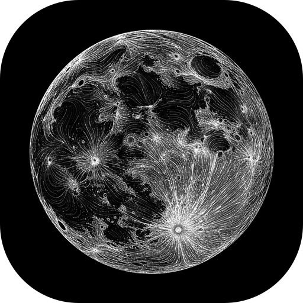

<p align="center">
  
</p>

<h1 align="center">AstroProcessor MCP Server</h1>

<p align="center">
  Your natal chart, forecasts, synastry and astromap from NASA/JPL-grade ephemeris data, in any AI assistant.
</p>

<p align="center">
  <a href="https://glama.ai/mcp/connectors/app.astroprocessor/astroprocessor"></a>
</p>

AstroProcessor is a hosted (remote) MCP server. There is nothing to install or run: you add one URL to your AI app and sign in with your AstroProcessor account.

```
https://mcp.astroprocessor.app/mcp
```

- **Transport:** Streamable HTTP
- **Auth:** OAuth 2.1 with PKCE (Dynamic Client Registration supported)
- **Account:** an AstroProcessor account; sign-up is free
- **Official MCP Registry:** `app.astroprocessor/astroprocessor`

Your birth data is saved once in your AstroProcessor profile, so every tool reads your own chart. The assistant gets exact positions from the server and does not guess them.

## Tools

16 tools. The chart tools read your own chart by default. Give them `chart` (a chart's name or id, from `list_charts`) to read any chart saved in your AstroProcessor dashboard instead: a family member's, a friend's or a client's.

| Tool | What it returns |
|---|---|
| `get_chart_data` | Your natal chart: planets, houses, angles, aspects, dignities, fixed stars, configurations |
| `get_transits` | Your transits for a date: the sky against your natal chart, with a dated timeline of exact passes |
| `get_directions` | Your symbolic directions for a date, with the dated timeline of exact contacts |
| `get_solar_return` | The solar return in force at a date: the chart for your year |
| `get_progressions` | Your secondary progressions for a date |
| `get_lunar_return` | Your lunar return: the chart for the current month |
| `get_synastry` | Another person's chart read against yours, from their birth date, time and city, or from a chart saved in your dashboard |
| `get_horary_chart` | A horary chart for the moment a question is asked (or a saved horary chart), with the traditional judgment layer: rulers, dignities, receptions, perfection, the void-of-course Moon |
| `get_relocation_place` | Your chart recast for another city, with your AstroMap lines near it |
| `search_astromap_cities` | Cities near your AstroMap lines (a planet on the MC, IC, ASC or DSC) |
| `get_moon_data` | The Moon's sign, phase and illumination, or the exact time of its next phase |
| `find_eclipse` | The next or previous solar and lunar eclipses, with their signs |
| `get_sunrise_sunset` | Sunrise and sunset for a day at a place |
| `find_city` | City lookup, for an unclear or ambiguous place name |
| `list_charts` | The charts saved in your dashboard, natal and horary, to pass as `chart` |
| `get_balance` | Your plan, credits and the price of the next message |

All tools are read-only, apart from `get_chart_data` saving your own birth data once to an empty profile. Charts use the tropical zodiac and classical Western astrology.

## Connect

**Claude (web or desktop):** Customize → Connectors → + Add → Add custom connector. Name: AstroProcessor, URL: the one above. Then sign in.

**ChatGPT (web):** Plugins (chatgpt.com/plugins) → + → Add custom MCP server. Name: AstroProcessor, Server URL: the one above, Authentication: OAuth. Create it as a plugin, then sign in.

**Claude Code:**

```bash
claude mcp add --transport http --scope user astroprocessor https://mcp.astroprocessor.app/mcp
```

**Gemini CLI:**

```bash
gemini mcp add --transport http --scope user astroprocessor https://mcp.astroprocessor.app/mcp
```

**Cursor, VS Code and other clients that read `mcp.json`:**

```json
{
  "mcpServers": {
    "astroprocessor": {
      "url": "https://mcp.astroprocessor.app/mcp"
    }
  }
}
```

Step-by-step guide for every app: https://astroprocessor.app/ai-connector

## Example questions

- "What does my natal chart say about my career?"
- "What is coming for me this year?"
- "How compatible are we? Her birth details are 14 March 1990, 08:30, Lisbon."
- "Which cities fall on my Venus lines in Europe?"
- "When is the next full Moon, and in which sign?"
- "Will I get this job?" (a horary question, judged from the moment it is asked)
- "What is coming this year for my sister? Her chart is saved as Anna."

## Usage and limits

A paid plan has unlimited messages. The Free plan includes free messages each day, then uses credits. `get_balance` shows where an account stands and costs nothing. Calls are rate-limited per account.

## Links

- Website: https://astroprocessor.app
- About the MCP server: https://astroprocessor.app/astrology-mcp-server
- Setup guide: https://astroprocessor.app/ai-connector
- Support: support@astroprocessor.app

This repository describes the hosted server; the server's own code is not published.
